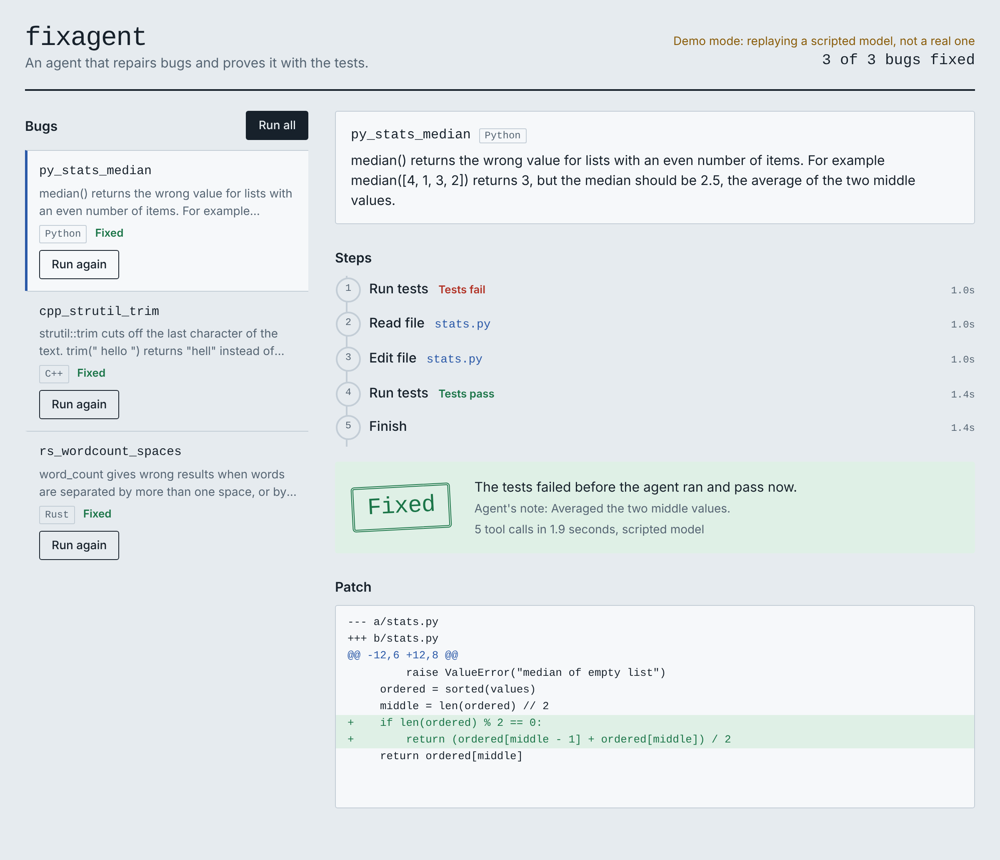

# fixagent

[](https://github.com/AmitDas856/fixagent/actions/workflows/tests.yml)

An AI agent that fixes bugs in Python, C++ and Rust repositories, with a
React dashboard for watching it work.



You give it a repository and a bug report, or a GitHub issue number. It
explores the code, runs the tests, edits the source, re-runs the tests, and
hands back a patch or opens a pull request. The result
is checked independently: a fix only counts if the tests fail before the agent
runs and pass after it.

## How it works

```
bug report ──► Agent loop (Python) ──► patch + verdict
                 │      ▲
        tool call│      │tool result
                 ▼      │
               Toolbox: list_files, read_file, search_code,
                        edit_file, write_file, run_tests, run_command
                              │
                              └─ search_code uses a small Rust CLI
```

| Part | Language | File |
| --- | --- | --- |
| Agent loop | Python | `fixagent/agent.py` |
| Tools and sandbox rules | Python | `fixagent/tools.py` |
| LLM client | Python | `fixagent/llm.py` |
| Run one issue and verify it | Python | `fixagent/runner.py` |
| Open a pull request | Python | `fixagent/pullrequest.py` |
| Fix-rate evaluation | Python | `fixagent/evaluate.py` |
| Dashboard API server | Python | `fixagent/server.py` |
| Dashboard | TypeScript, React | `dashboard/` |
| Fast code search | Rust | `tools/codesearch/` |
| Demo bugs | Python, C++, Rust | `demo_repos/` |

The Python code has no third-party runtime dependencies. The Rust tool uses
only the standard library.

## Safety rules built into the tools

- The agent works on a copy. Your repository is never modified.
- Every path must stay inside that copy, including through symlinks.
- Test files are read-only, so the agent cannot pass by weakening a test.
- Commands run without a shell, from a short allowlist, with a timeout.
- The model's own claim of success is ignored. The runner re-runs the tests.

The agent still runs the repository's build and test code, so use it inside a
container or virtual machine for code you do not trust.

## Setup

Requirements: Python 3.10+, and for the C++ and Rust demos `g++`, `make` and
`cargo`.

```bash
git clone https://github.com/AmitDas856/fixagent.git
cd fixagent

# optional: build the Rust search tool (the agent falls back to Python without it)
cd tools/codesearch && cargo build --release && cd ../..

# run the tests (offline, no API key needed)
pip install pytest
python -m pytest
```

## Run it with a real model

The agent talks to any server with an OpenAI-style `/chat/completions`
endpoint that supports tool calling. Set three environment variables:

```bash
export FIXAGENT_BASE_URL="https://your-provider.example/v1"
export FIXAGENT_MODEL="your-model-name"
export FIXAGENT_API_KEY="your-key"     # leave unset for a local server
```

For a model running locally through Ollama, the base URL is
`http://localhost:11434/v1` and no key is needed.

Fix one bug:

```bash
python -m fixagent \
  --repo demo_repos/cpp_strutil \
  --issue 'trim("  hello  ") returns "hell" instead of "hello"' \
  --out fix.patch --log run.jsonl
```

Fix a GitHub issue and open a pull request for it:

```bash
python -m fixagent --repo path/to/your/checkout --github-issue 12 --open-pr
```

This needs the [GitHub CLI](https://cli.github.com/) installed and signed in
(`gh auth login`). The fix goes on a new `fixagent/...` branch, never on the
branch you are on, and a pull request is only opened when the fix is verified.
The repository must have no uncommitted changes.

Measure the fix rate over all demo tasks:

```bash
python -m fixagent.evaluate demo_repos/tasks.json
```

## Dashboard

A React and TypeScript web app that shows each bug, the agent's steps as they
happen, the verdict, and the patch.

```bash
cd dashboard
npm install
npm run build        # type-checks, then builds into dashboard/dist
cd ..
python -m fixagent.server --tasks demo_repos/tasks.json
```

Then open http://127.0.0.1:8000. Requires Node.js 20 or newer.

With no model settings, the server runs in **demo mode**: it replays a
scripted model for the demo bugs, and the dashboard says so at the top. Set
the three `FIXAGENT_*` variables before starting the server to use a real
model. The server has no login and listens on your own machine only.

For front-end development, run `npm run dev` in `dashboard/` alongside the
Python server. It reloads on save and forwards `/api` calls to port 8000.

## Hack support (experimental)

`demo_repos/hack_cart` is a fourth demo bug, written in
[Hack](https://hacklang.org/). The agent detects Hack projects by their
`.hhconfig` file and runs `hhvm tests/run_tests.hack`. This has **not been
run**: the Hack code and the agent's Hack path were written without access to
HHVM. To try it, with Docker installed:

```bash
docker run --rm -v "$PWD/demo_repos/hack_cart":/app -w /app hhvm/hhvm hhvm tests/run_tests.hack
```

One test should fail until the bug is fixed. With HHVM on your PATH, the task
file is `demo_repos/tasks_hack.json`.

## Run it on GitHub Actions

Two workflows are in `.github/workflows/`:

- **Tests** runs on every push. It builds the Rust tool and runs the test
  suite with the scripted model, so it needs no API key.
- **Run agent with a real model** is started by hand from the Actions tab. Add
  `FIXAGENT_BASE_URL`, `FIXAGENT_MODEL` and `FIXAGENT_API_KEY` under
  Settings > Secrets and variables > Actions first. It prints the fix-rate
  table on the run page and saves the results as a download.

## Demo bugs

| Task | Language | Bug |
| --- | --- | --- |
| `py_stats_median` | Python | `median` is wrong for even-length lists |
| `cpp_strutil_trim` | C++ | `trim` cuts off the last character (off by one) |
| `rs_wordcount_spaces` | Rust | `word_count` miscounts repeated spaces, tabs, newlines |

## What is tested

`python -m pytest` runs 68 tests offline (one is skipped unless HHVM is
installed). A scripted stand-in for the model
replays the tool calls a real model would make, which exercises the whole
loop: the agent fixes all three demo bugs, and is correctly marked as failed
when it makes a wrong fix, changes nothing, tries to edit the tests, or runs
out of steps. The HTTP client and command line are tested against a local
fake server. The pull request step is tested against a local git remote and
a stand-in for the `gh` command. The dashboard's API server is tested over
real HTTP, and GitHub Actions type-checks and builds the dashboard.

## Not done yet

- The Hack demo and Hack support have not been run with HHVM.
- The dashboard has no automated browser tests.

- It has not been run with a real model. That needs an API key or a local model.
- The pull request step has not been run against the real GitHub API.
- The evaluation covers three small demo bugs, not a public benchmark.

## License

MIT. See [LICENSE](LICENSE).
